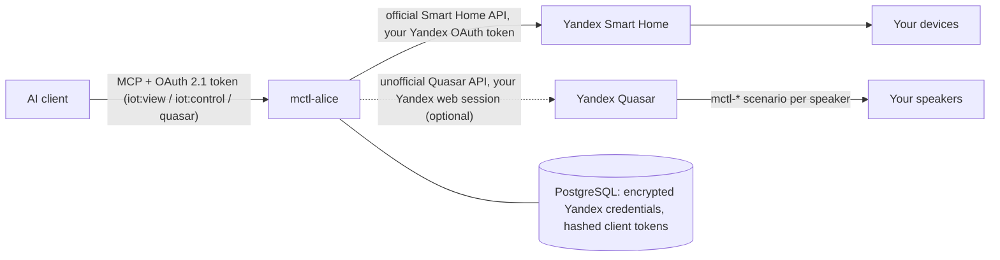

# mctl-alice

Model Context Protocol (MCP) server for controlling **Yandex Station (Алиса)** smart speakers and smart home devices through the official Yandex Smart Home API and, optionally, the unofficial Quasar API.

Enables AI assistants (Claude, ChatGPT, Codex, Antigravity, OpenClaw, Cursor, etc.) to speak through your Alice speakers, send voice commands, control volume and playback, and manage your smart home.

---

## Deployment Modes

### 1. Hosted Multi-Tenant SaaS (Recommended)
You can connect your AI assistant directly to our hosted cloud gateway at **`https://alice.mctl.ai`**:

1. Open **`https://alice.mctl.ai`** in your browser.
2. Click **Войти через Яндекс ID** to authenticate your Yandex Smart Home.
3. Configure **Quasar Cookie** (via QR code) if you wish to control smart speakers with TTS phrases.
4. Add the MCP endpoint to your client:
   - **Claude Desktop / Codex / ChatGPT MCP**: `https://alice.mctl.ai/mcp`
   - Complete the standard OAuth 2.1 consent screen in your client.

### 2. Self-Hosted (Docker)
You can deploy your own instance of `mctl-alice` using Docker:

```bash
docker run -d \
  --name mctl-alice \
  -p 8080:8080 \
  -v $(pwd)/data:/app/data \
  -e AUTH_REQUIRED=true \
  -e PUBLIC_BASE_URL=https://your-domain.com \
  -e ENCRYPTION_KEY=0123456789abcdef0123456789abcdef0123456789abcdef0123456789abcdef \
  -e YANDEX_CLIENT_ID=your_yandex_client_id \
  -e YANDEX_CLIENT_SECRET=your_yandex_client_secret \
  ghcr.io/mctlhq/mctl-alice:<version>   # e.g. 2.2.7, see Releases
```

Set `PUBLIC_BASE_URL` to the exact origin browsers use to reach the server. With `AUTH_REQUIRED=true`, the account pages, the consent form and the credential forms accept a `POST` only from that origin. Without auth, they and browser requests to `/mcp` and `/api/*` are accepted only from that origin or from a loopback host (`localhost`, `127.0.0.1`, `[::1]`). Pages still load from any name, but a server reached as `http://nas.local:3000` without a matching `PUBLIC_BASE_URL` rejects its own forms and requests with 403.

### Request limits

Bodies are capped at 64 KiB (forms) and 1 MiB (MCP/REST JSON, `MAX_MCP_BODY_BYTES`), and OAuth, sign-in and MCP routes are rate limited per client (`RATE_LIMIT_REGISTER|TOKEN|AUTHORIZE|LOGIN|QR|MCP`, requests per minute). Behind a reverse proxy set `TRUST_PROXY_HOPS` to the number of trusted proxies so the client address is taken from `X-Forwarded-For`; set it only behind a proxy you control, since otherwise clients can spoof their rate-limit key. See `SECURITY.md` for the defaults.

---

## Available MCP Tools

| Tool Name | Scope | Description |
| :--- | :--- | :--- |
| `alice_list_devices` | `iot:view` | Lists speakers, rooms, smart home devices and scenarios. |
| `alice_get_device_state` | `iot:view` | Returns the current state, capabilities and sensor values of a device. |
| `alice_get_home_summary` | `iot:view` | Returns a readable overview of rooms and devices. |
| `alice_get_device_history` | `iot:view` | Returns stored telemetry samples. The hosted service does not sample telemetry, so it returns no new data there. |
| `alice_control_device` | `iot:control` | Turns a device on or off and sets temperature, mode or brightness. |
| `alice_set_light` | `iot:control` | Sets a light's power, brightness, color temperature or scene. |
| `alice_control_room` | `iot:control` | Controls every device of a category in a room or the whole home, e.g. all lights off. |
| `alice_trigger_scenario` | `iot:control` | Runs a scenario defined in Yandex Smart Home. |
| `alice_set_volume` | `iot:control` | Sets speaker volume (1 to 10). |
| `alice_media_control` | `iot:control` | Playback commands: play, pause, stop, next, previous. |
| `alice_say_phrase` | `quasar` | Makes a speaker say arbitrary text (TTS). |
| `alice_send_command` | `quasar` | Sends a text command as if spoken, e.g. "Включи джаз". |

The read-only tools also accept a token with only `iot:control`. `quasar` tools need the Quasar connection described below.

## How data flows



- **Official API.** Device listing, state and control use the documented Yandex Smart Home API with the OAuth token you grant at sign-in.
- **Unofficial API.** Speech and text commands use Quasar, the internal API of the Yandex web interface, with your Yandex web session cookie. Yandex does not support it for third parties and may change it without notice, and the session grants broader access than OAuth. It is off until you connect it, and disconnecting removes the cookie and the `mctl-*` scenarios.
- **What is stored, where and for how long** is listed on the [privacy page](https://alice.mctl.ai/privacy).

## Not affiliated with Yandex

mctl-alice is an independent project. It is not affiliated with, endorsed or supported by Yandex. Yandex, Alice (Алиса) and Yandex Station are trademarks of their respective owners.

---

## Security Architecture & Threat Model

- **Multi-Tenant Cryptographic Isolation**: All upstream access tokens, refresh tokens, and Quasar session cookies are encrypted at rest using **AES-256-GCM**. The `userId` is passed as Additional Authenticated Data (AAD), cryptographically binding ciphertext to the user's record.
- **Hashed Bearer Secrets**: MCP access and refresh tokens, authorization codes, browser session ids and login-transaction keys are stored only as SHA-256 digests. Rows written by versions before 2.2.3 are rewritten on PostgreSQL in a second step, see [Upgrading to hashed secrets](#upgrading-to-hashed-secrets).
- **Granular Scopes**: AI client grants are scoped to `iot:view`, `iot:control`, and `quasar`.
- **Operator Trust Boundary**: Because `mctl-alice` acts as an MCP proxy to Yandex Cloud, upstream tokens must be held in process memory at the moment of request dispatch. We transparently disclose that the infrastructure operator has access to the runtime environment, and envelope encryption protects data-at-rest.
- **Data Erasure**: Users can revoke AI client access and permanently delete all stored data with a single click at `/account`.


### Upgrading to hashed secrets

Pods from before 2.2.3 look secrets up by their raw value, so on a shared PostgreSQL database the rewrite is a separate, operator-triggered step:

1. Deploy the new version without `REHASH_STORED_SECRETS`. New secrets are stored hashed, old rows keep working through a raw-value fallback, and each start logs how many stored secrets are still in clear text.
2. Once no pre-2.2.3 pod serves traffic, set `REHASH_STORED_SECRETS=true`. The next start rewrites the remaining rows in one transaction and logs the count.
3. Unset the variable again once the log reports no clear-text rows; leaving it set only repeats a no-op scan on every start.

SQLite deployments run a single process, so they rehash on start without a flag.

### Rotating the encryption key

`ENCRYPTION_KEY` alone encrypts everything in the unversioned `v1` envelope. For rotation, configure named keys: `ENCRYPTION_KEYS` lists `id:key` pairs separated by commas (each key 32 bytes as 64 hex or 44 standard base64 characters, e.g. `openssl rand -base64 32`; no passphrases; ids of `[A-Za-z0-9_-]`), and `ENCRYPTION_KEY_ID` names the one new values are encrypted under, as `v2:<id>:iv:tag:ct`; without it, new values stay `v1`. Every listed key decrypts values written under its id; a value under an id that is not listed fails closed (HTTP 503), it is never treated as plaintext. An inconsistent configuration stops the server at startup.

1. **Deploy this version first.** Releases before key ids treat a `v2` value as plaintext and would send ciphertext upstream as a token. Set `ENCRYPTION_KEY_ID` only once no older pod serves traffic, as a separate change after the version rollout, also with a single replica.
2. **Add the new key.** List it next to the current one, e.g. `ENCRYPTION_KEYS=k2:<new>` while keeping `ENCRYPTION_KEY` for existing `v1` values (or `ENCRYPTION_KEYS=k1:<old>,k2:<new>` when rotating away from a named key). With more than one replica, first roll out the list without changing `ENCRYPTION_KEY_ID`, so every pod can read the new key before any pod writes with it; then set `ENCRYPTION_KEY_ID=k2`.
3. **Re-encrypt.** Set `REENCRYPT_STORED_CREDENTIALS=true` and restart. Shortly after start, a background pass rewrites stored credentials that are not under the active key, one conditional update per value (a value changed by a request in the meantime is left alone, it already uses the active key), and logs how many were stale, rewritten and undecryptable. Without the flag the pass only reports. On PostgreSQL the server does not wait for the pass; on SQLite it runs during start. Either way a failed pass is logged, the server keeps serving, and the pass runs again on the next start.
4. **Retire the old key.** Once a start reports `0` stale (or only values reported as undecryptable, which no configured key opens and which you decide to drop), unset `REENCRYPT_STORED_CREDENTIALS`, then wait at least 10 minutes (login, consent and QR transactions are encrypted too, are not counted, and live 10 minutes) and remove the old key (`ENCRYPTION_KEY` or its `ENCRYPTION_KEYS` entry). Keep a copy of it until the backups taken before step 3 have aged out: they still need it (a point-in-time restore within the 14-day backup retention needs the key that was active at the target time; see [the restore runbook](docs/runbooks/restore-database.md)).

---

## License

Apache-2.0. See [LICENSE](LICENSE) for details.
